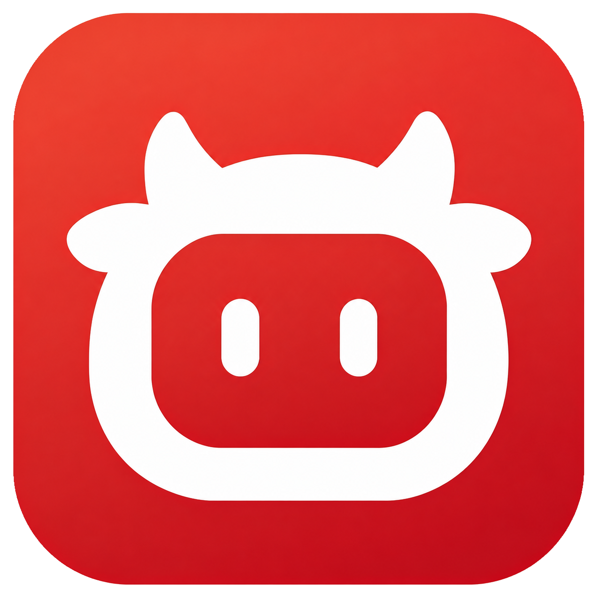
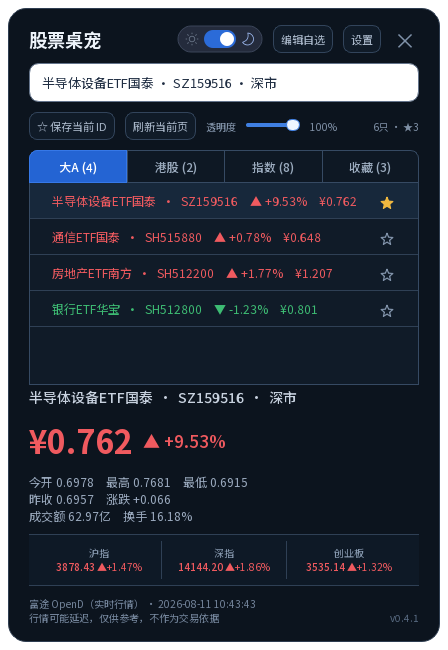
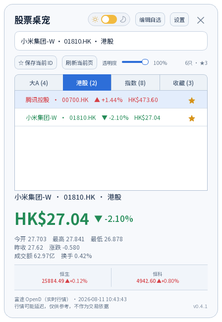
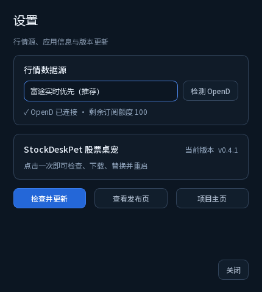
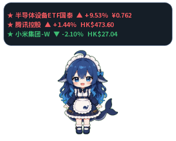

<p align="center">
  
</p>

# 股票桌宠 StockDeskPet

[](LICENSE)

Windows 股票桌宠 MVP：点击桌宠显示或隐藏行情卡。支持美股、港股、沪市、深市，并预留北交所代码识别。

<p align="center">
  
</p>

<p align="center"><sub>富途 OpenD 实时行情优先 · 腾讯行情自动兜底 · 深浅双主题</sub></p>

## 当前功能

- 透明、无边框、始终置顶的牛市桌宠
- 专属股票牛宠应用图标，统一用于 EXE、桌面快捷方式、安装包和系统托盘
- 标题栏滑动开关切换深色/浅色主题；行情卡、编辑窗和桌宠气泡同步换肤并自动保存选择
- 行情卡支持 `90%–100%` 显示透明度并自动保存，避免透明度过低看不清内容
- 独立设置页显示当前版本；安装版可一键检查、下载、替换并自动重启
- 设置页可选择“富途实时优先”或“腾讯延迟行情”，并检测本机 OpenD 连接状态
- 左键拖动并记住位置
- 单击桌宠：显示或隐藏行情卡，不触发行情刷新
- 搜索框支持股票代码和名称；输入“小米”“英伟达”“NVDA”等会弹出大A/港股/美股候选，选择后直接拉取行情
- 行情卡用“大A / 港股 / 美股”Tab 自动区分自选股，并直接展示列表；收藏 Tab 保持在最后
- 港股默认加入腾讯控股 `00700` 和小米集团-W `01810`
- 大A默认加入半导体设备 `159516`、通信 `515880`、房地产 `512200`、银行 `512800` 四只ETF
- 美股默认加入英伟达 `NVDA`、SpaceX `SPCX`、美光科技 `MU`、特斯拉 `TSLA`、闪迪 `SNDK`
- 独立“指数”Tab：恒指、恒科、国企指数、上证、沪深300、深成指、创业板、道琼斯、纳斯达克综合、标普500和伦敦现货金
- 点击列表中的股票即可拉取详细行情
- 每条股票、指数和黄金行情右侧都有 `☆ / ★` 收藏按钮；收藏项固定每 5 秒独立刷新
- 独立“收藏”Tab 汇总已收藏的股票、指数和黄金，可直接查看行情或取消收藏
- 收藏气泡每页可用滑块设置 `0–10` 条（默认 5 条，0 为隐藏），切换间隔 `1–30` 秒（默认 10 秒）；气泡字号支持 `80%–150%` 调整
- 点击“刷新当前页”只请求当前 Tab；切换 Tab 时会在对应市场交易时段自动刷新该页
- 行情卡打开期间，当前 Tab 固定每 10 秒静默刷新；关闭行情卡即停止
- 首次启动或第一次打开对应 Tab 时仍会加载一次最近行情；之后的自动刷新遵循北京时间交易时段：大A 09:30–11:30、13:00–15:00，港股 09:30–12:00、13:00–16:00；周末停止大A、港股和黄金刷新
- 切换 Tab 时默认选中第一项；大A页底部显示沪指、深指、创业板，港股页显示恒生、恒科
- 点击“保存当前 ID”加入自选；点击“编辑自选”批量增删并持久化
- 自选股后台轮询，达到设置的涨跌幅阈值时弹出 Windows 系统通知
- 提醒阈值支持 `0.5%–20%`，检查间隔提供 `30 秒–5 分钟` 常用档位
- 港股示例：`00700`、`700`、`HK00700`、`0700.HK`
- A 股示例：`600519`、`SH600519`、`600519.SS`、`000001`、`SZ000001`
- 美股示例：`NVDA`、`US.AAPL`、`TSLA.US`、`BRK.B`；个股/ETF支持自选、收藏、提醒和富途一键导入
- 行情涨跌不会自动更换皮肤；中国市场配色为红涨绿跌
- 默认皮肤为“DSH 蓝毛女仆 · 动画版”；已有用户手动选择的皮肤会保留，右键可切换其他皮肤，选择会自动保存。原“默认牛”更名为“经典牛”，仍可选择，也作为动画资源不可用时的兜底
- CodexPet 图集皮肤支持状态动画：待机、手动刷新、左右拖拽和点击挥手
- 新增“DeepSeek 女仆 · 表情版”：采用 [keleus/deepseek-pet](https://github.com/keleus/deepseek-pet) 的 MIT 授权高清表情素材，支持待机轮换/眨眼、点击庆祝、拖拽受惊、手动刷新时工作；长时间待机会变为饥饿、抱枕和睡觉状态
- 新增“DSH 蓝毛女仆 · 动画版”：采用 [PC2005-cloud/dsh-pet](https://github.com/PC2005-cloud/dsh-pet) 的 106 段原版透明 GIF；右键「播放动作」按互动、玩耍、吃东西、时节等分类点播，播完自动回到待机。单击仍切换行情卡，同时随机播放点击回应；拖拽有悬空反馈，手动刷新播放工作动作。
- DSH 皮肤待机约 20 秒后穿插一段随机小动作，可在右键菜单关闭；隐藏时暂停播放，按需解码当前动画，不预加载整套素材。未接入原项目的 AI 聊天、漫游或抛掷，不需要安装 DSH/Electron。
- 收藏、自选检查和打开页定时刷新保持待机动画，仅手动拉取或刷新时播放刷新动画
- 系统托盘支持显示、刷新、隐藏、退出

## 界面预览

<table>
  <tr>
    <td width="50%" align="center">
      <br>
      <b>浅色主题与港股行情</b>
    </td>
    <td width="50%" align="center">
      <br>
      <b>行情源与 OpenD 检测</b>
    </td>
  </tr>
</table>

<p align="center">
  <br>
  <b>桌宠收藏行情气泡</b>
</p>

## 自选股与提醒

1. 在行情卡输入代码，点击“☆ 保存当前 ID”。
2. 点击右上角“编辑自选”，每行填写一个股票 ID。
3. 设置提醒阈值和检查间隔，点击“保存”。
4. 桌宠会在后台检查自选股；同一只股票保持在同一方向阈值外时只提醒一次，回到阈值内后再次突破才会重新提醒。

保存后，6 位 A 股代码会进入“大A”Tab，最多 5 位的港股代码会进入“港股”Tab；点击任意列表项即可查看详情。

美股保存为带市场前缀的 `US.NVDA` 等代码，进入“美股”Tab，不与原有指数/黄金别名混淆
（如黄金矿业股票使用 `US.GOLD`，现货黄金仍是 `GOLD`）。
升级后会一次性补入上述五只默认美股，不改变已有收藏、不重复添加，也不会重新勾选已隐藏的股票；
自选库满 100 只时保留原有内容，只补入剩余名额。后续手动删除不会在重启后恢复。

## 美股行情

美股股票与 ETF 优先使用富途 OpenD；权限或连接不可用时回退腾讯公共行情。
道琼斯、纳斯达克综合、标普500默认加入“指数”Tab，并在“美股”页底部显示；
这三个指数直接使用腾讯，不占 OpenD 订阅额度。无需手动添加或自动改动已有收藏。

美股时间标注为“美东”，个股/ETF 自动刷新与气泡覆盖四个时段：

- 盘前：周一至周五 04:00–09:30
- 盘中：周一至周五 09:30–16:00
- 盘后：周一至周五 16:00–20:00
- 夜盘：周日至周四 20:00–次日 04:00，归属于次一交易日

自动适配夏令时和北京时间跨日；周五盘后再延长 30 分钟拉取最后行情，20:30 后停止自动刷新及气泡。
三个美股指数仍只按美东工作日 09:30–16:30 刷新，不将指数当作夜盘股票。
目前按常规周时段运行，尚未接入交易所节假日及提前收市日历；休市仍可手动查看最近行情。

盘前/盘后/夜盘使用 OpenD 的分时段报价及 `Session.ALL` 逐笔订阅，
以同一时段内真实成交的价格和美东时间为准，不把普通报价的收盘时间标到夜盘价上。
列表、详情、气泡和提醒都带时段标识。无行情权限、该股票不支持对应时段、
或没有当前时段的有效成交时，明确显示常规参考行情；不反复重连 OpenD，额外订阅失败会退避 5 分钟。
腾讯备用源仅作为常规行情，不能替代夜盘。已有较新的缓存不会被旧收盘价覆盖，
跨时段缓存标记“历史”，超过 2 分钟未有新成交的报价标记“旧”，详情保留真实报价时间。
盘前/盘后/夜盘涨跌以该时段基准收盘价计算；缺少的开盘价、换手率不混用常规盘数据。
美股提醒按交易日和时段去重，夜盘跨午夜不会重复提醒，也不会用昨日常规收盘触发夜盘提醒。
公开网页接口可能延迟、限流或调整，不能视为有时效保障的实时数据服务。

## 指数与黄金

“指数”Tab 固定展示 11 项行情，应用启动和自选刷新时会同步更新。可在输入框直接使用：

- 港股指数：`HSI`、`HSTECH`、`HSCEI`
- 大A指数：`SHCOMP`、`CSI300`、`SZCOMP`、`CHINEXT`
- 美股指数：`DJI`（道琼斯）、`IXIC`（纳斯达克综合）、`SPX`（标普500）
- 黄金：`GOLD`，对应伦敦现货黄金，价格单位为美元/盎司

指数无需加入自选，也不会触发自选股涨跌幅系统提醒。

自选列表、提醒阈值、轮询间隔和桌宠位置均保存在当前 Windows 用户配置中，重启应用后仍然有效；行情详情启动时保持空白，点击列表或手动拉取后再显示。

## 启动

在 PowerShell 中运行：

```powershell
cd C:\Users\Admin\StockDeskPet
.\run.ps1
```

第一次运行会在项目内创建 `.venv` 并安装 PySide6、富途 OpenAPI SDK 等依赖，后续直接启动。

## 富途 OpenD 实时行情

默认使用“富途实时优先”模式，自动检查本机 `127.0.0.1:11111`。
没有运行 OpenD 也能正常使用：后台先做超时为 100 毫秒的端口检查，未开启时直接
使用腾讯行情，不初始化富途 SDK，并缓存未运行状态 5 分钟，避免每轮刷新重复等待。
缓存到期后的下一次行情请求会重新检测；点击“检测 OpenD”可立即重新检测。
端口开启仅表示服务可连接，是否能获取实时行情仍需由 OpenD 登录状态和权限决定。

1. 安装并启动富途官方 OpenD，在 OpenD 中由用户自行登录。
2. 打开桌宠“设置”，保留“富途实时优先（推荐）”，点击“检测 OpenD”。
3. 检测成功后，受支持的大A、港股、美股股票/ETF和恒生指数行情从 OpenD 读取；搜索、恒科/国企指数、美股三大指数及黄金仍使用腾讯接口。
4. OpenD 未启动、未登录、没有订阅额度或缺少对应行情权限时，桌宠自动回退腾讯行情。

OpenD 只负责行情连接，桌宠不会保存富途账号、密码或验证码。富途实时行情是否可用取决于账号的市场权限与订阅额度。

## 只验证行情接口

无需安装 GUI 依赖即可用系统 Python 检查：

```powershell
python -m stock_pet.quote_provider 00700 600519 000001
```

## 测试

### 界面卡顿日志

程序自动监测界面心跳。超过 3 秒未响应时，独立于 Qt 界面线程和 Python GIL
的原生看门狗会将所有 Python 线程堆栈写到本机日志，恢复后记录心跳间隔及
最近的页面、皮肤和刷新任务状态。持续卡住只抓取一次，恢复后才重新启用检测。
系统休眠或挂起也可能造成心跳间隔变长，需结合堆栈判断，并不等于程序死锁。
详情渲染、列表更新、切换 Tab 或打开行情卡耗时达到 100 毫秒时，还会记录
`SLOW_UI` 操作名和耗时；渲染期间只缓存在内存，下一次心跳统一写入日志。

日志位置：`%LOCALAPPDATA%\StockDeskPet\logs\ui-stalls.log`。
每份约 2 MB，最多保留当前文件和 2 份轮转备份；不记录变量内容、账号或行情数据，
也不会上传。若再次卡住，先保留这些日志再重启程序，便于定位原因。

### 自动化测试

```powershell
python -m unittest discover -s tests -v
```

## 打包 EXE

```powershell
.\build.ps1
```

生成目录：`dist\StockDeskPet\`。Velopack 要求 PyInstaller 使用 `onedir`，不支持 `onefile`。

同时生成一键安装包和自动更新包：

```powershell
.\build.ps1 -Package
```

安装包与更新文件位于 `Releases\`。安装后的“设置 → 检查并更新”会从本项目的 GitHub Releases 下载新版本，替换完成后自动重启。

## 行情边界

默认优先读取本机富途 OpenD 的实时行情缓存，并以腾讯公共网页行情作为自动兜底与搜索数据源。OpenD 数据仍受账号权限、订阅额度和富途服务条款约束；腾讯接口可能延迟、限流或变更。两者都只适合桌面行情提示，不应作为下单依据。行情访问分别封装在 `stock_pet/hybrid_quote_provider.py` 与 `stock_pet/quote_provider.py`。

## 素材

经典牛、熊和涨跌图标来自 Microsoft Fluent UI Emoji GitHub 仓库；五套本机皮肤来自 CodexPet.xyz。DSH 蓝毛女仆动画来自 PC2005-cloud/dsh-pet。来源、许可说明和文件哈希见 `THIRD_PARTY_NOTICES.md` 与 `assets/skins/README.md`。

## 许可证

本项目原创源代码采用 [MIT License](LICENSE)。Microsoft 素材和 CodexPet.xyz
社区皮肤等第三方资产不包含在本项目的 MIT 授权范围内，仍分别受其原始许可和
授权条款约束，详见 [THIRD_PARTY_NOTICES.md](THIRD_PARTY_NOTICES.md)。
